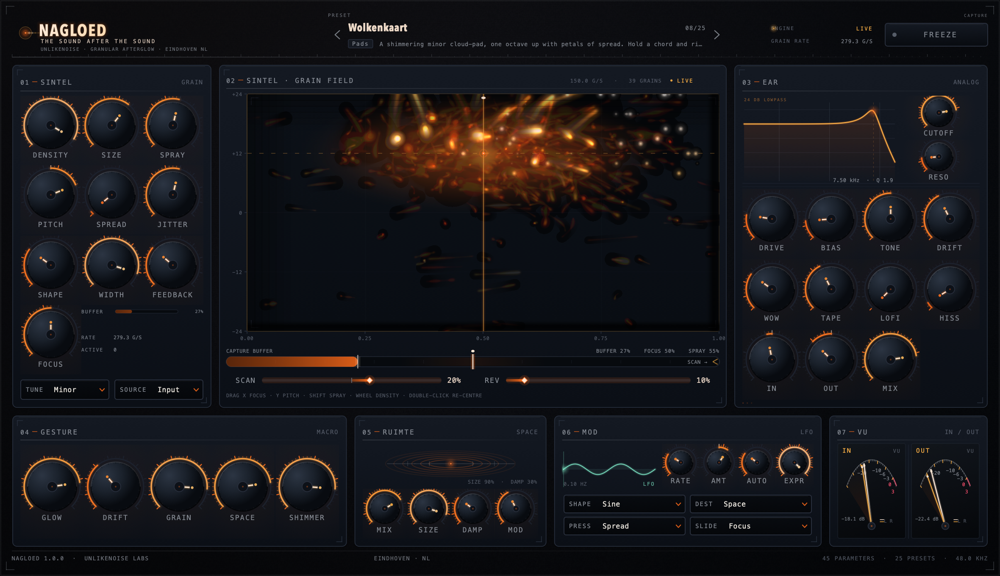

# NAGLOED

**The sound after the sound.**

NAGLOED is a granular effect and instrument for macOS, built for people who treat
sound as material. It captures live audio, breaks it into grains, and lets the
remains glow: Sintel grains, Ruimte space, EAR analog colour.

> *nagloed* (Dutch, noun) — the light that stays in the room after the source is gone.

Version **1.0.0** · macOS 12+ · AU / VST3 / Standalone · GPL-3.0-or-later ·
UnlikeNoise Labs



## What it is

Feed NAGLOED a synth, a voice, a bowed string or a field recording. It holds up
to twelve seconds in a capture buffer, reads that material as short grains, and
places them in a room. Freeze the buffer and the source can stop — the grains
keep playing what is left. With **Source** set to Noise or Drone it can also make
sound with no input at all.

It is an insert effect, not a sampler: no file loading, no sample mapping, no
MIDI notes. The material is whatever you play into it, and the instrument's job is
the afterglow.

**Who this is for:** experimental musicians, modular players, sound artists,
field recordists, improvisers and one-take recorders — and sound designers who
need texture that behaves like material rather than like a preset. If you want a
finished sound in one click, this is the wrong instrument. If you want to hold a
moment and play what remains, read on.

## Features

**Sintel — grain engine**

- Twelve-second capture buffer and up to 256 simultaneous grains.
- Density, grain length, spray, scan, pitch, spread, reverse, jitter, window
  shape, stereo width, grain feedback and focus.
- Freeze stops recording new input while the grains keep reading.
- Tuning modes: Free, Chromatic, Minor, Major, Dorian, Phrygian, Pentatonic,
  Whole-tone.
- Source modes: Input, Noise, Drone.

**Ruimte — space**

- Space, Size, Damp and Mod, from a close room to a long, moving tail.

**EAR — analog section**

- Drive, Bias, Tone, Cutoff, Reso, Drift, Wow, Tape, LoFi and Hiss, plus In/Out
  trim and dry/wet Mix. A nod to the *Emotional Analog Resonance* label.

**Performance**

- Five gesture macros: Glow (tape warmth), Drift (instability), Grain (cloud
  shape), Space (room), Shimmer (octave sparkle).
- One LFO (six shapes, six destinations plus Off) and Auto-motion for long evolves.
- Resizable editor (1180 × 680 default) with a live grain cloud.
- Full host automation and session state; presets exposed as plug-in programs.

**Formats**

- AU, VST3 and Standalone for macOS 12 or later.
- Mono and stereo plug-in configurations.
- 24 factory presets across eight categories, embedded in the binary, plus Init.

## Install

Builds from this repository are copied into the user plug-in folders automatically
(`COPY_PLUGIN_AFTER_BUILD` is enabled):

```
~/Library/Audio/Plug-Ins/Components/NAGLOED.component
~/Library/Audio/Plug-Ins/VST3/NAGLOED.vst3
```

The standalone app stays in the build tree:

```
build/NAGLOED_artefacts/Release/Standalone/NAGLOED.app
```

If your host cannot see a freshly built plug-in, rescan its plug-in folders or
restart the host. To copy the artefacts by hand:

```bash
./scripts/build.sh
cp -R build/NAGLOED_artefacts/Release/AU/NAGLOED.component ~/Library/Audio/Plug-Ins/Components/
cp -R build/NAGLOED_artefacts/Release/VST3/NAGLOED.vst3      ~/Library/Audio/Plug-Ins/VST3/
```

Local builds are unsigned. macOS may ask you to confirm the standalone app the
first time it runs.

## Build from source

Requirements:

- macOS 12 or later, with Xcode Command Line Tools (`xcode-select --install`).
- CMake 3.22 or later for `./scripts/build.sh`; CMake 3.25 or later if you use the
  CMake presets (`CMakePresets.json` uses schema v6).
- Python 3 (used at build time to embed `presets/*.json`).
- Network access for the first JUCE download only; after that the build is
  offline and reproducible from `.deps/JUCE`.

```bash
# once
xcode-select --install
./scripts/fetch-juce.sh          # JUCE 9.0.5 into .deps/JUCE

# every build
./scripts/build.sh               # plugin + dev tools
./scripts/build.sh NAGLOED       # just the plug-in
./scripts/build.sh nagl_tests    # just the test runner
```

`scripts/build.sh` configures a Release build in `build/` and builds with the
available CPU cores. CMake presets are also provided (CMake 3.25+):
`cmake --preset local`, `cmake --build --preset local`.

### Developer tools

The tools compile the same sources as the plug-in, so what they render is what
ships:

| Tool | What it does |
|---|---|
| `nagl_tests` | Unit and smoke tests: parameter layout, presets, processor stability, state round-trip. |
| `nagl_render` | Renders the 84-second demo performance through the real processor to `Demo/Nagloed-Demo.wav`. |
| `nagl_preview` | Renders the real editor offscreen to `docs/ui-preview.png`. |

Disable them with `-DNAGLOED_BUILD_TOOLS=OFF` for a plug-in-only build.

## Validation status

| Check | Command | Status |
|---|---|---|
| DSP + unit tests (164 checks) | `./build/nagl_tests_artefacts/Release/nagl_tests` | PASS |
| AU validation | `auval -v aufx Nagl UnlN` | PASS |
| pluginval, strictness 10 (VST3 + AU) | `pluginval --strictness-level 10 --validate …` | PASS |
| Offline render | `./build/nagl_render_artefacts/Release/nagl_render` | PASS — writes `Demo/Nagloed-Demo.wav` |
| Offscreen editor snapshot | `./build/nagl_preview_artefacts/Release/nagl_preview` | PASS — writes `docs/ui-preview.png` |

The full evidence (commands, observed output, CPU/latency figures) is in
[docs/VALIDATION.md](docs/VALIDATION.md).

`./scripts/validate.sh` rebuilds everything, runs the tests and then validates the
AU component with `auval`. The CI workflow
(`.github/workflows/ci.yml`) runs the same checks on a macOS runner; it is
manual/release-only to keep runner minutes predictable.

`Demo/Nagloed-Demo.wav` is rendered through the full engine: 84 seconds,
48 kHz / 24-bit stereo, peaking at −2.1 dBFS. Regenerate it with
`./build/nagl_render_artefacts/Release/nagl_render`. The render's spectrogram is
in [docs/demo-spectrogram.png](docs/demo-spectrogram.png).

## Project layout

| Path | Contents |
|---|---|
| `src/core/` | Frozen contracts: parameter IDs, ranges, defaults, `EngineParams`, `VisualState`, `PresetAccess`. |
| `src/dsp/` | Sintel, Ruimte and EAR implementation behind the `Engine` pimpl. Audio-thread safe. |
| `src/ui/` | Editor and look-and-feel. Talks to audio only through `VisualSource` and APVTS. |
| `src/plugin/` | `NagloedProcessor`: APVTS, bus layout, state, presets, program list. |
| `presets/` | Factory presets as JSON, embedded at build time by `scripts/gen_presets.py`. |
| `tools/` | Headless test, render and UI-preview applications. |
| `tests/` | Test runner sources. |
| `scripts/` | JUCE fetch, build, validation and preset generation. |
| `docs/` | Brand, manual, architecture and release notes. |

Rules of the codebase: the GUI never includes `src/dsp/`, the DSP layer never
includes `src/ui/`, and parameter IDs in `src/core/ParamIDs.h` are permanent.
See [docs/ARCHITECTURE.md](docs/ARCHITECTURE.md).

## Contributing

Development follows a small gitflow: `main` is released code, `develop` is the
integration branch, and work arrives as `feature/*` branches with a pull request
against `develop`. Issues are labelled by workstream (`dsp`, `ui`, `docs`,
`presets`, `infra`). The pull request template
(`.github/PULL_REQUEST_TEMPLATE.md`) asks for evidence — the build command, test
output and, for GUI changes, a screenshot. DSP changes must also pass the realtime
checklist: no allocation, locks or file I/O in `process()`, smoothed parameter
changes, finite output under extreme settings.

The full workflow — branches, worktrees, commit conventions, review and release —
is in [docs/CONTRIBUTING.md](docs/CONTRIBUTING.md).

This is a small, local-first project. Read the manual and the architecture doc
before changing signal flow, and keep the afterglow intact.

## License

NAGLOED's own source is free software under the **GNU General Public License,
version 3 or later** (GPL-3.0-or-later). See [LICENSE](LICENSE).

JUCE is used under its own licensing, separate from NAGLOED's GPL. NAGLOED builds
against JUCE 9.0.5; the JUCE 9 terms are the [JUCE 9 EULA](https://juce.com/legal/juce-9-licence/).
The GPL in this repository grants no rights to JUCE, and building or distributing
NAGLOED requires you to hold an appropriate JUCE licence of your own.

## Credits

Designed and directed by **Leon van Bokhorst / UnlikeNoise**, Helmond, the
Netherlands, and made by **UnlikeNoise Labs**. Built with
[JUCE](https://juce.com) 9.

The sound world owes a debt to the Eindhoven/Helmond experimental scene:
[Modulab Eindhoven](https://sonicrider.nl/modulab-eindhoven/) (Leon van Bokhorst,
Allard Krijger, Jurgen Winkel), the one-take sessions with
[SONICrider](https://sonicrider.nl/category/collaborations/unlikenoise/), and the
[EAR](https://sonicrider.nl/ear/) label's *Emotional Analog Resonance*.

### How this was built

NAGLOED 1.0 was made in a small, AI-assisted process. The concept, naming,
parameter design, sound decisions and final review are human. AI coding agents
implemented and documented large parts of the codebase under human direction and
review. Nothing is generated at runtime; the plug-in ships as reviewed source
under GPL-3.0-or-later.

## Documentation

- [Brand and design language](docs/BRAND.md)
- [Manual](docs/MANUAL.md)
- [Release notes — v1.0.0](docs/RELEASE_NOTES.md)
- [Architecture](docs/ARCHITECTURE.md)
- [Preset guide](docs/PRESET_GUIDE.md)
